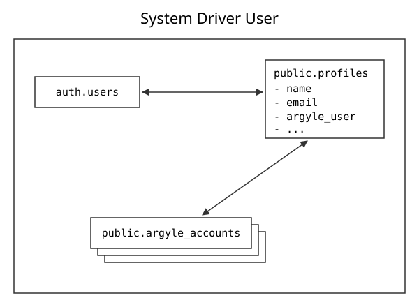

# Sample System

## Developing

### Prerequesites

1. Node and node version manager (nvm)
2. Docker Desktop
3. `pnpm` package manager. [Follow this guide](https://pnpm.io/installation) to install `pnpm`.

### Setting up the database

You will need to set up a version of [Supabase](https://supabase.com/) on your local computer.
Please follow the [Supabase Local Development & CLI](https://supabase.com/docs/guides/local-development)
instructions, which cover how to set his up.

Please use the `pnpm` option when following instructions in the Supabase documentation

### Setting up the code

Install Node.js version 22. Other versions of node may not work.

```commandline
nvm install 22.14.0
nvm use 22.14.0
```

We currently use `pnpm` version `10.17.1`.

```bash
# install the dependenties...
pnpm install

# and run the server
pnpm dev
```

Copy the `.env.example` file and complete the placeholder environment variables.

Note that using your browser's network tab can be very useful in troubleshooting
your installation.

### IDE selection

We strongly suggest using VS Code as your IDE. Recommended extensions include:

- Svelte for VS Code
- i18n Ally
- Prettier
- ESLint

### Receiving Argyle webhooks locally (local tunnel)

To test Argyle webhook functionality during local development, you need to expose your
local dev server to the internet so Argyle can deliver webhook events to it.

We use [localtunnel](https://github.com/localtunnel/localtunnel) for this. Three
subdomains are available so multiple developers can run tunnels simultaneously:

```bash
pnpm tunnel      # https://sample.loca.lt
pnpm tunnel:2    # https://sample2.loca.lt
pnpm tunnel:3    # https://sample3.loca.lt
```

Coordinate with teammates to pick different subdomains.

**Setup steps:**

1. Start the dev server: `pnpm dev`
2. In a separate terminal, start a tunnel: `pnpm tunnel`
3. Sandbox Webhooks are enabled on Argyle for all 3 tunnels (sample, sample2, sample3)
4. Set the secret and copy it into your `.env` as `ARGYLE_WEBHOOK_SECRET`
   (find it in the Argyle Console under your sandbox webhook settings)

**Note:** On first visit, localtunnel shows an IP confirmation page. Click through it
to allow traffic. This is a one-time step per tunnel session.

### Creating a production build

```bash
# Build the production site
pnpm build

# Preview the production site
pnpm preview
```

### Code style and format

We use Prettier for formatting and eslint for linting. We also use `svelte-check`
to check for other code hygeine issues. ([More info](https://svelte.dev/docs/cli/sv-check))

```bash
# Run the linter
pnpm lint:fix

# Run the formatter
pnpm format:fix

# Run svelte-check
pnpm check
```

### Testing

All of our testing runs as part of our Continuous Integration pipeline.

#### Unit and database tests

We use [vitest](https://vitest.dev/), split into two projects by what a test
needs to run (see `vitest.workspace.ts`):

| Command              | Runs                  | Needs Supabase? |
| -------------------- | --------------------- | --------------- |
| `pnpm test:unit`     | `*.spec.ts`           | no              |
| `pnpm test:db`       | `*.db.spec.ts`        | yes             |
| `pnpm test`          | both                  | yes             |
| `pnpm test:watch`    | `*.spec.ts`, watching | no              |
| `pnpm test:coverage` | both, with coverage   | yes             |

`pnpm test:unit` takes a couple of seconds and needs no Docker, so it is the
loop to stay in while writing code. A test that reaches the database belongs in
a `*.db.spec.ts` file.

Both projects run their files in parallel, which holds only because no fixture
is shared: users, phone numbers, organizations and Argyle identifiers are
generated per run and torn down by whoever created them (see
`tests/utils/testUser.ts`), and no spec asserts on a table-wide count. When
adding a spec, avoid a `.delete()` without an `.eq()` and avoid asserting on
every row in a table — either one forces the suite back to running one file at a
time.

The exception is the phone numbers pinned to a fixed OTP in
`supabase/config.toml`: those cannot be unique, so each spec file owns its own
set. Add a new pair there rather than borrowing one.

If a run is interrupted and leaves users behind, `pnpm test:clean-users` removes
them.

#### End-to-end (e2e) testing

We use playwright for e2e tests. Run them with `pnpm run test:e2e`.

To inspect tests, it can be useful to run `pnpm exec playwright test --ui`,
which will bring up a testing GUI with screenshot recordings so you can troubleshoot
failing or flaky tests.

Argyle is stubbed locally (`tests/argyleStub.ts`), so the suite needs no Argyle
credentials and does not depend on the sandbox staying connected. To run against
the real sandbox instead: `ARGYLE_LIVE=1 pnpm run test:e2e`. The webhook specs
address Argyle resources by id, and generated ids exist only in the stub, so a
live run also needs `ARGYLE_LIVE_USER`, `ARGYLE_LIVE_ACCOUNT` and
`ARGYLE_LIVE_IDENTITY` from a connected sandbox account — without them those
specs skip.

The stub replays recorded sandbox responses from `tests/fixtures/argyle`, so the
shapes are Argyle's rather than someone's guess at them. Refresh them with
`pnpm run snapshot:argyle-stub`, which needs `VITE_ARGYLE_API_KEY` /
`VITE_ARGYLE_API_SECRET` and a connected sandbox account (reconnect
test1@argyle.com through Argyle Link if the recorder reports none). Tokens, SSNs
and pagination cursors are redacted as they are recorded; ids are regenerated
per request when served, so two test drivers never share an Argyle account.

### Internationalization

Note that for pluralization we require this syntax:

```
$_('key.id', {values: {foo: bar})
```

## Supabase

We use Supabase as our [database](https://supabase.com/docs/guides/database/overview) and [authentication](https://supabase.com/docs/guides/auth) platform.

### Common database commands

```bash
# Reset the database
npx supabase db reset


# Seed the database with seeds for the organizer feature.
# Ensure .env file is in the pwd before running this.
node --loader ts-node/esm data-migrations/seedDatabase.ts

# Generate TypeScript types based on the databsase schema
npx supabase gen types typescript --local > src/lib/schema.ts
```

### Using SMS auth

We configure several testing phone numbers for SMS one time passwords (OTPs):

- Phone: 12223334444, OTP: 555555
- Phone: 18009000010, OTP: 808181
- Phone: 18009000020, OTP: 808282
- Phone: 18009000030, OTP: 808383

These OTPs will always work for logging in with these phone numbers.

The 12223334444 number is configured for the organizer login. The 1800 numbers
correspond to the profiles in the [Argyle sandbox](https://docs.argyle.com/overview/sandbox-testing), which can be used for testing the driver login.

## FAQ

### How do Argyle users, Supabase users, and Argyle accounts relate to each other?

The user representation in our database looks like the following:



- **auth.users** is a table controlled by Supabase for auth, and
  includes, e.g., a `user_id` and a hashed password if applicable.
- **public.profiles** maps 1:1 to auth.users and contains user profile
  information, e.g., their name and email and argyle_user ID. See [Argyle Documentation](https://docs.argyle.com/overview/data-structure/users)
- **public.argyle_accounts** maps many:1 to public.profiles and contains
  information about a user's connected account. See [Argyle Documentation](https://docs.argyle.com/overview/data-structure/accounts)

### What happens if my branch is out of date with the main branch?

It is normal for a feature branch to become out of date with the main branch:
as other contributors merge in their code, your branch may "fall behind".

To bring your branch back up to date:

1. Run `git fetch origin`, which will download any of the latest changes to
   the git repository to your machine (without applying them to your branch)
1. Run `git merge origin/main`, which will apply the changes from the main
   branch on the origin (i.e., GitHub) to the feature branch.

### Help! My git state is broken!

If, for whatever reason, your git state has become broken, messy, stuck in a
merge conflict, or similar, try:

1. Asking another contributor for help
1. Making a new branch:
   1. Check out the latest code from GitHub with `git fetch origin`
   1. Open the latest code with `git checkout origin/main`
   1. Check out a new feature branch, e.g `myname/my-feature-branch-2`,
      replacing `myname/my-feature-branch` with your feature branch name.
   1. Re-applying the commits we've previously made with `git cherry-pick`
      or otherwise redoing our changes. (One hack is to save copies of files
      whose changes we want to keep in another directory, creating the new branch,
      and then pasting in the modified files.)

### How does the team work with Linear? (task management)

This is the recommended lifecycle for working through a Linear ticket from start to finish:

1. Start the issue and update the status to "In Progress". This is a good opportunity to ask
   clarifying questions about the ticket and make sure you have everything you need
   to complete it.
1. Copy the branch name from the ticket to the clipboard with `ctrl-shift-period` (or `cmd-shift-period`)
1. Go to the console on your computer:

   1. Run `git checkout main`. This moves us to the `main` branch.
   1. Update the local version of the main branch with `git pull origin main`.
      This ensures that we're working with the latest version of the code, which
      will reduce the possibility of merge conflicts later on.
   1. Check out a new feature branch with `git checkout -b <ctrl-v / cmd-v>`,
      replacing `<ctrl-v / cmd-v>` with the branch name on your clipboard.
      _Note: using this branch name will automatically link your code to the Linear
      ticket, which is useful to keep the two connected.
      It also enables the Linear status to map to the GitHub status with automations._

1. Make the required code changes
1. Push the branch to GitHub with `git push origin myname/my-feature-branch`,
   replacing `myname/my-feature-branch` with your feature branch name.
1. Open a Pull Request on Github to point your feature branch at `main`.
   _Note: the Linear status will auto-move to "In Progress" if it isn’t already._
1. Request and complete a review with another code contributor.
   _Note: the Linear status will auto-move to "In Review" when you request a review._
1. Once a positive review is complete, merge the feature branch into the `main` branch.
   _Note: the Linear status will auto-move to "QA" when you merge the PR._
1. Complete QA (reference the top-most comment in the PR for a guide).
1. Mark the Linear ticket as "Done" when QA is complete.
1. (optional) Delete the feature branch from your development environment with
   `git branch -d myname/my-feature-branch`, replacing `myname/my-feature-branch`
   with your feature branch name.
