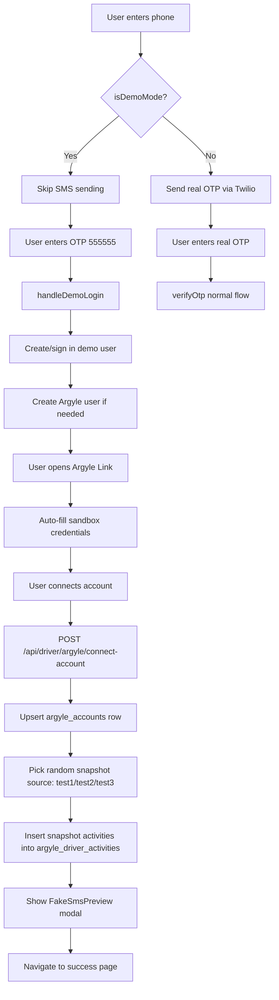

# Demo Mode Developer Guide

This document covers everything developers need to know about System's demo mode system.

## Overview

Demo mode provides a self-contained experience for demonstrating System without external API dependencies. It's deployed at `demo.getsystem.org` and allows users to:

- **Drivers:** Log in with a fixed OTP code (no real SMS sent), connect an Argyle sandbox account with auto-filled credentials, and view 120 pre-generated rideshare activities with realistic take rates
- **Organizers:** Log in with signup code + any phone + OTP `555555`, and view mock member data for demo organizations (nstlte, plc, aass)

### Activation

Demo mode is controlled by the `VITE_IS_DEMO` environment variable:

```bash
# .env
VITE_IS_DEMO=true
```

The flag is detected at runtime via:

```typescript
// src/lib/utils.ts
export const isDemoMode = import.meta.env.VITE_IS_DEMO === 'true';
```

## Architecture



## Demo-Aware Endpoints (Server)

| Endpoint                                  | File                                                                                                                     | Demo Behavior                                                                                |
| ----------------------------------------- | ------------------------------------------------------------------------------------------------------------------------ | -------------------------------------------------------------------------------------------- |
| `POST /driver/login`                      | [src/routes/driver/login/+server.ts](../../src/routes/driver/login/+server.ts)                                           | Skips SMS sending, returns 200 immediately                                                   |
| `POST /driver/verify-otp`                 | [src/routes/driver/verify-otp/+server.ts](../../src/routes/driver/verify-otp/+server.ts)                                 | Accepts `555555`, creates password-based user                                                |
| `POST /api/auth/verify-otp`               | [src/routes/api/auth/verify-otp/+server.ts](../../src/routes/api/auth/verify-otp/+server.ts)                             | Accepts `555555`, returns existing session                                                   |
| `POST /api/driver/argyle/connect-account` | [src/routes/api/driver/argyle/connect-account/+server.ts](../../src/routes/api/driver/argyle/connect-account/+server.ts) | Inserts up to 200 activities from a random Argyle sandbox snapshot (`test1`/`test2`/`test3`) |
| `POST /api/driver/argyle/webhooks`        | [src/routes/api/driver/argyle/webhooks/handleWebhook.ts](../../src/routes/api/driver/argyle/webhooks/handleWebhook.ts)   | Skips all webhook processing                                                                 |
| `GET /driver/settings` (load)             | [src/routes/driver/settings/+page.server.ts](../../src/routes/driver/settings/+page.server.ts)                           | Returns mock Argyle account; if no activities yet, inserts the snapshot fixture for the user |
| `POST /organizer/login`                   | [src/routes/organizer/login/+server.ts](../../src/routes/organizer/login/+server.ts)                                     | Skips whitelist and SMS when signup code matches demo org                                    |
| `POST /organizer/verify-otp`              | [src/routes/organizer/verify-otp/+server.ts](../../src/routes/organizer/verify-otp/+server.ts)                           | Accepts `555555`, creates organizer user + affiliation                                       |

## Demo-Aware Components (Client)

| Component                                                                                              | Purpose                                                                          |
| ------------------------------------------------------------------------------------------------------ | -------------------------------------------------------------------------------- |
| [UseArgyle.svelte](../../src/lib/components/driver/UseArgyle.svelte)                                   | Shows credential sidebar/mobile panel, auto-prefills forms, shows FakeSmsPreview |
| [DriverOtpLogin.svelte](../../src/lib/components/DriverOtpLogin.svelte)                                | Adjusts driver login flow for demo                                               |
| [organizer/login/+page.svelte](../../src/routes/organizer/login/+page.svelte)                          | Adjusts organizer login flow for demo (signup codes hint, OTP prefill)           |
| [ConfirmIdentityWithOtpModal.svelte](../../src/lib/components/Auth/ConfirmIdentityWithOtpModal.svelte) | Accepts demo OTP                                                                 |
| [DemoCredentialsSidebar.svelte](../../src/lib/components/driver/DemoCredentialsSidebar.svelte)         | Desktop credential display                                                       |
| [CopyableCredentialRow.svelte](../../src/lib/components/driver/CopyableCredentialRow.svelte)           | Copy-to-clipboard credential row                                                 |
| [FakeSmsPreview.svelte](../../src/lib/components/driver/FakeSmsPreview.svelte)                         | Simulated SMS modal                                                              |

## Demo-Specific Modules

| Module                                                                                       | Purpose                                                                                                      |
| -------------------------------------------------------------------------------------------- | ------------------------------------------------------------------------------------------------------------ |
| [src/lib/demo/constants.ts](../../src/lib/demo/constants.ts)                                 | OTP codes, passwords, Argyle sandbox credentials, URLs                                                       |
| [src/lib/demo/messages.ts](../../src/lib/demo/messages.ts)                                   | Client-side SMS message generation                                                                           |
| [src/lib/server/demoData.ts](../../src/lib/server/demoData.ts)                               | `loadDemoArgyleActivities()` — picks one of `test1`/`test2`/`test3` and returns insert-ready rows            |
| [src/lib/server/demoArgyleSandboxGigs.json](../../src/lib/server/demoArgyleSandboxGigs.json) | Snapshot of real Argyle sandbox gigs for `test1`/`test2`/`test3@argyle.com`, regenerated by the script below |
| [data-scripts/snapshotArgyleSandboxGigs.ts](../../data-scripts/snapshotArgyleSandboxGigs.ts) | Regenerates the snapshot from a local Supabase DB (`pnpm snapshot:argyle-sandbox`)                           |
| [src/lib/stores/demoMessages.ts](../../src/lib/stores/demoMessages.ts)                       | SMS message store                                                                                            |
| [src/lib/stores/userDemoPhoneNumber.ts](../../src/lib/stores/userDemoPhoneNumber.ts)         | Phone store + `sendDemoSMSMessages()`                                                                        |
| [data-scripts/makeDemoOrganizerSeeds.ts](../../data-scripts/makeDemoOrganizerSeeds.ts)       | Creates mock drivers for demo orgs (run via `pnpm seed:demo-organizers`)                                     |

## Key Constants

```typescript
// src/lib/demo/constants.ts

DEMO_OTP = '555555'; // Fixed OTP for System login
DEMO_PASSWORD_PREFIX = 'demo-system-'; // Password prefix for demo users
DEMO_BASE_URL = 'https://demo.getsystem.org/';

// Argyle sandbox test user "Bob Jones"
ARGYLE_SANDBOX_BOB = {
  email: 'test1@argyle.com',
  password: 'passgood',
  username: 'test_1',
  phone: '8009000010',
  verificationCode: '8081',
  driversLicense: 'D1230010',
  mfaCode: '8081'
};

ARGYLE_SANDBOX_OTP = '808181'; // 6-digit OTP for Argyle MFA
```

## Organizer Demo

Organizers can demo the organizer experience on the demo site:

1. Visit `/organizer/login`
2. Enter signup code: `nstlte`, `plc`, or `aass` (one of the three demo organizations)
3. Enter any phone number (e.g. `1555555555`)
4. Click Submit → OTP input appears (no SMS sent)
5. Enter OTP `555555`, click Verify
6. Redirected to `/organizer/org/nstlte` (or plc/aass)
7. View mock member list with trip data

### Mock Members Seed Script

To populate demo organizations with mock drivers, run after `npx supabase db reset`:

```bash
pnpm seed:demo-organizers
```

This creates 4 mock drivers per demo org (nstlte, plc, aass), each with profiles, affiliations, data-sharing consents, and up to 200 rideshare activities pulled from the same Argyle sandbox snapshot the driver demo uses (each driver gets a random pick from `test1`/`test2`/`test3`). Run manually when setting up a fresh demo database.

## Database

### Demo User Pattern

- Email: `{phone}@demo.system.local`
- Password: `demo-system-{phone}`

## Argyle Sandbox Configuration

In demo mode, Argyle Link is configured differently:

| Setting   | Demo Value | Production Value |
| --------- | ---------- | ---------------- |
| `sandbox` | `true`     | `false`          |
| `flowId`  | `5HEE9HC8` | `QM3BSPT2`       |

### Auto-Prefill

The `startDemoPrefill()` function in [createArgyleLinkInstance.ts](../../src/lib/client/createArgyleLinkInstance.ts):

1. Observes Argyle Link's shadow DOM for form fields
2. Detects input type by `name`, `inputmode`, and `placeholder` attributes
3. Auto-fills with sandbox credentials using native HTMLInputElement setters
4. Triggers React state updates to make values stick

### Webhooks

All webhooks are completely skipped in demo mode:

```typescript
// handleWebhook.ts
if (isDemoMode) {
  console.log('[handleWebhook] Demo mode - skipping all webhook processing');
  return;
}
```

## Demo Data Generation

`loadDemoArgyleActivities()` is the single source of demo activity rows for both the driver demo flow (`connect-account`, `/driver/settings` first-load fallback) and the organizer seed (`pnpm seed:demo-organizers`). It:

- Reads [src/lib/server/demoArgyleSandboxGigs.json](../../src/lib/server/demoArgyleSandboxGigs.json), a committed snapshot of real gigs for `test1`/`test2`/`test3@argyle.com` captured from a local Supabase DB.
- Picks one of the three sources at random for each demo driver.
- Inserts up to `MAX_DEMO_DRIVER_ACTIVITIES` (currently 200) rows per driver.
- Re-anchors every timestamp so the latest gig lands at "now" (preserves the gaps between trips so charts look natural).
- Generates fresh row IDs and overwrites `user`/`account`/`account_id` for the target demo driver. `ride_hash` is generated by the DB trigger.

This makes both demo flows look like real Uber Driver accounts that actually completed Argyle Link — data has a mix of `completed` and `cancelled` rides, real NY locations, real fee/income shapes, etc.

### Refreshing the snapshot

Argyle sandbox accounts age out roughly every 60 days, and the snapshot only contains as much data as our local DB had at capture time. To refresh:

1. In a local Supabase, connect three drivers via Argyle Link using sandbox `test1@argyle.com`, `test2@argyle.com`, and `test3@argyle.com`. The drivers must have phone numbers `18009000010`, `18009000020`, and `18009000030` respectively (the script looks them up by phone).
2. Wait for the gigs sync to complete on each.
3. Run `pnpm snapshot:argyle-sandbox` — this writes `src/lib/server/demoArgyleSandboxGigs.json` with the most recent 200 gigs per source. Override the cap with `ARGYLE_SANDBOX_MAX_GIGS=N` (set `0` for unlimited).
4. Commit the regenerated JSON.

## Testing

Demo-specific tests are located in:

- [src/lib/server/demoData.spec.ts](../../src/lib/server/demoData.spec.ts) - Unit tests for activity generation
- [src/routes/api/driver/demo-flow.spec.ts](../../src/routes/api/driver/demo-flow.spec.ts) - Integration tests for demo login/data flows

Run them with:

```bash
npx vitest run src/lib/server/demoData.spec.ts src/routes/api/driver/demo-flow.spec.ts
```

## Checklist: Adding Demo Handling to a New Feature

When building a new feature, ask yourself these questions:

### 1. Does the feature call an external API?

If yes, add an `if (isDemoMode)` guard that returns mock/simulated data instead:

```typescript
if (isDemoMode) {
  return buildMockResponse();
}
// Real API call
const response = await externalApi.fetch(...);
```

### 2. Does the feature rely on webhook-delivered data?

If yes, generate equivalent data in the connect-account endpoint or settings loader. Demo mode skips all webhooks, so data must be pre-populated.

### 3. Does the feature send SMS or email?

If yes, skip the actual sending and optionally add a client-side preview:

```typescript
if (isDemoMode) {
  demoMessages.addMessages(generateDemoMessages());
  return;
}
await sendRealSms(phoneNumber, message);
```

### 4. Does the feature display user data?

Usually no changes needed - demo data uses the same schema as production. The UI should work automatically with demo activities.

### 5. Does the feature add a new database column?

Consider whether demo users need:

- A default value for the new column
- Special handling in demo-specific code paths
- Mock data generation to include the new field

### 6. Do you need new constants?

Add any fixed demo values to [src/lib/demo/constants.ts](../../src/lib/demo/constants.ts) to maintain a single source of truth.

### 7. Have you added tests?

Add demo-specific test cases to the relevant `*.spec.ts` file. Mock `isDemoMode` via `vi.mock()`:

```typescript
vi.mock('@src/lib/utils', async (importOriginal) => {
  const actual = await importOriginal<typeof import('@src/lib/utils')>();
  return { ...actual, isDemoMode: true };
});
```

## Common Patterns

### Checking Demo Mode

```typescript
import { isDemoMode } from '@src/lib/utils';

if (isDemoMode) {
  // Demo-specific behavior
} else {
  // Normal behavior
}
```

### Creating Demo-Only UI

```svelte
<script>
  import { isDemoMode } from '@src/lib/utils';
</script>

{#if isDemoMode}
  <DemoCredentialsSidebar />
{/if}
```

### Generating Demo Messages

```typescript
import { userDemoPhoneNumber } from '@src/lib/stores/userDemoPhoneNumber';

// After account connection
userDemoPhoneNumber.sendDemoSMSMessages();
```

## Troubleshooting

### Demo user creation fails

Check that the Supabase service role key has permission to create users with `auth.admin.createUser()`.

### Activities not appearing

1. Verify `isDemoMode` is true
2. Check the connect-account endpoint was called after Argyle Link closed
3. Look for errors in `argyle_driver_activities` insert logs

### Credentials not auto-filling

1. Argyle Link loads its UI in a shadow DOM - check browser DevTools
2. The MutationObserver may not have detected the form yet
3. Verify `startDemoPrefill()` is being called

> **Known fragility:** The `startDemoPrefill` implementation in
> `createArgyleLinkInstance.ts` couples directly to Argyle Link's internal
> shadow DOM structure — specifically `[data-hook="auth-input"]` selectors,
> `name` attributes (`username`, `password`, `phone`, `legacy_mfa_token`),
> and `inputmode`/`placeholder` heuristics to distinguish field types across
> platforms. If Argyle ships a Link SDK update that changes these internals,
> auto-fill will break silently. **Retest the demo Argyle flow whenever the
> Argyle Link SDK version is upgraded.**

### Webhooks still processing

Ensure `isDemoMode` is checked at the top of `handleWebhook.ts` before any other logic.
